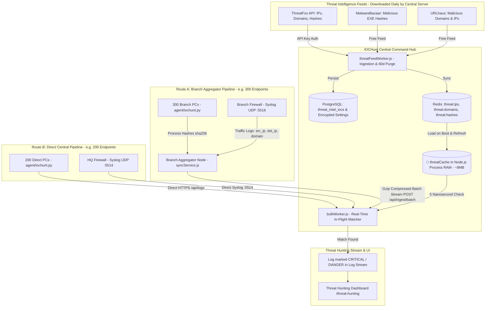

# IOCHunt — Complete Threat Hunting Architecture, Aggregator Flow & UI Implementation Plan

This document establishes the definitive end-to-end plan for integrating **Automated Threat Intelligence (TI) Ingestion & Real-Time Threat Hunting** into IOCHunt. It covers the dual-ingestion pipeline (Branch Aggregators + Direct Endpoints), centralized API key security, and the complete UI design matching IOCHunt's existing dark-mode design system.

---

## 1. Dual-Ingestion & Aggregator Architecture

IOCHunt seamlessly handles both **Branch Aggregator Nodes** (e.g. 300 branch machines behind an on-prem aggregator) and **Direct Endpoints / Firewalls** connecting directly to the Central Server.



---

## 2. Key Architecture Principles

### 1. Centralized Threat Download (No Aggregator Overhead)
* **The API Key is entered ONLY ONCE in the Central Server UI.**
* **Branch Aggregators NEVER touch Abuse.ch:**
  * Prevents Abuse.ch from banning the company's API key due to multiple branch IPs calling simultaneously.
  * Branch nodes save internet bandwidth and do not need extra RAM.
  * Aggregators forward logs to Central Server via `syncService.js` every 2 to 5 seconds.

### 2. Universal Matching Engine in `bulkWorker.js`
* Logs arriving from **Branch Aggregators** (Route A) and logs arriving from **Direct Endpoints** (Route B) pass through the exact same `bulkWorker.js` pipeline on Central Server.
* The in-memory `threatCache` tests every log in **`0.000005 ms` (5 nanoseconds)**:
  * Firewall `dst_ip` / `src_ip` $\rightarrow$ tested against `threatCache.ips`
  * Firewall `domain` $\rightarrow$ tested against `threatCache.domains`
  * Endpoint `sha256` $\rightarrow$ tested against `threatCache.hashes`
* If a match occurs:
  * The log is tagged `severity = 'critical'`, `is_alert = true`, `logdesc = '[THREAT DANGER] ...'`.
  * **No automatic P1 incident tickets are created** (preventing ticket spam), but the event is highlighted in bright red on the **Threat Hunting** and **Firewall** pages.

### 3. Military-Grade AES-256 API Key Storage
* The ThreatFox API key is **never stored in plaintext**.
* The server encrypts the key using **AES-256-GCM** with the server's master secret (`APP_SECRET`).
* Stored in the PostgreSQL `settings` table as `threat_intel_config`.
* When needed for daily sync, the worker decrypts the key in-memory and injects it into the `Auth-Key` HTTP header.

### 4. 60-Day Automatic Rotational Purge
* All threats in PostgreSQL, Redis, and Node.js RAM are kept on a **60-day rolling window**.
* Daily cleanup query:
  ```sql
  DELETE FROM threat_intel_iocs WHERE last_seen < NOW() - INTERVAL '60 days';
  ```
* Total storage footprint permanently stays under **~70 MB Disk** and **~30 MB RAM**.

---

## 3. Dedicated "Threat Hunting" UI Page Specification

A dedicated page is added at `/threat-hunting`, positioned in the **Sidebar** under the **"Detection"** section.

### Visual Styling & Design System Alignment:
* **Backgrounds:** `var(--surface)` (#121722 / #1e2538) and `var(--bg)`.
* **Borders:** `1px solid var(--border)` (rgba(255,255,255,0.08)).
* **Typography:** `Outfit` / `Inter`, monospaced coordinates in `var(--mono)`.
* **Icons:** Material Symbols Outlined (`material-symbols-outlined`).
* **Metric Cards:** Reusable `PremiumCard` component.
* **Badges & Colors:**
  * Critical / Danger: `#f04f5a` (Red)
  * High: `#f97316` (Orange)
  * Feed Badges: ThreatFox (`#a855f7`), MalwareBazaar (`#22d47a`), URLhaus (`#3b82f6`).

---

### UI State 1: Locked / Setup Wizard (When API Key is Not Set)

If no API key is configured in the database, the page presents an onboarding card:

```
┌─────────────────────────────────────────────────────────────────────────────┐
│ 🛡️  Threat Intelligence Integration Setup                                  │
│                                                                             │
│ Real-time threat hunting compares your firewall and endpoint logs against   │
│ 100,000+ active malware C2s, phishing domains, and malicious binaries.      │
│                                                                             │
│ ThreatFox Auth-Key:                                                         │
│ [ •••••••••••••••••••••••••••••••••••• ] 👁️ (Show/Hide)                    │
│ ℹ️ Don't have a key? Get your free key at threatfox.abuse.ch                │
│                                                                             │
│ Active Threat Feeds:                                                        │
│ [x] Abuse.ch ThreatFox (C2 Public IPs & Domains)                            │
│ [x] Abuse.ch MalwareBazaar (Malicious EXE Hashes - 100% Free)               │
│ [x] Abuse.ch URLhaus (Malicious Domains & IPs - 100% Free)                  │
│                                                                             │
│ [ 🚀 Verify, Encrypt & Connect ]                                            │
└─────────────────────────────────────────────────────────────────────────────┘
```

* **Action:** Clicking **"Verify, Encrypt & Connect"**:
  1. Sends a test query to `https://threatfox-api.abuse.ch/api/v1/` to validate the key.
  2. If valid, encrypts with AES-256-GCM and saves to `settings`.
  3. Triggers initial threat ingestion in the background.
  4. Automatically transitions the UI to **State 2 (Active Dashboard)**.

---

### UI State 2: Active Threat Hunting Dashboard (2 Tabs)

#### Top Metrics Bar (Using `PremiumCard`):
```
┌─────────────────┐  ┌─────────────────┐  ┌─────────────────┐  ┌─────────────────┐
│ Active Threats  │  │ Matches Today   │  │ Matched IPs     │  │ Matched Hashes  │
│     114,820     │  │       4         │  │       3         │  │       1         │
│  All 3 Feeds    │  │  Live Detection │  │ Firewall Level  │  │ Endpoint Agent  │
└─────────────────┘  └─────────────────┘  └─────────────────┘  └─────────────────┘
```

#### Tab Navigation Bar:
```
[ 🚨 Threat Detections (Matches) ]       [ 📚 Threat Database (Feed Indicators) ]
```

---

### 📋 TAB 1: "Threat Detections (Matches)"
Displays all incoming logs (from **Direct Endpoints** OR **Branch Aggregators**) that matched a known threat indicator.

#### Filter Bar:
* **Search:** Free text search across IP, domain, machine name, malware name.
* **Type Filter:** `All Types` | `IP` | `Domain` | `SHA256 Hash`.
* **Branch / Aggregator Filter:** `All Sources` | `Direct Central` | `Dubai-Aggregator` | `London-Aggregator` | etc.
* **Time Range:** `Last 24 Hours` | `Last 7 Days` | `Last 30 Days` | `Custom Range`.
* **Refresh Button:** Live poll toggle or instant manual refresh.

#### Table Columns:

| Timestamp | Machine / Device | Branch / Aggregator | Type | Matched Indicator | Malware Family | Feed | Severity |
| :--- | :--- | :--- | :---: | :--- | :--- | :---: | :---: |
| `Oct 28, 09:15` | `Sales-PC-142` | `Dubai-Aggregator` | <span className="badge-ip">IP</span> | `185.173.235.233` | VShell Botnet | ThreatFox | 🔴 **CRITICAL** |
| `Oct 28, 09:20` | `HR-Laptop-340` | `Direct Agent` | <span className="badge-domain">Domain</span> | `handsorneindo.com` | RemcosRAT | URLhaus | 🔴 **CRITICAL** |
| `Oct 28, 09:28` | `Finance-PC-89` | `London-Aggregator` | <span className="badge-hash">SHA256</span> | `0ff44fa50bf37...` | AMOS Stealer | MalwareBazaar | 🔴 **CRITICAL** |

---

### 📚 TAB 2: "Threat Database (Feed Indicators)"
A searchable catalog allowing security analysts to inspect all active threats currently loaded into IOCHunt's database and memory.

#### Filter Bar:
* **Search Indicator:** Instantly search any IP, domain name, or file hash.
* **Feed Filter:** `All Feeds` | `ThreatFox` | `MalwareBazaar` | `URLhaus`.
* **Type Filter:** `All Types` | `IP` | `Domain` | `SHA256`.
* **Total Counter:** Displays `Showing 114,820 active indicators (Retained for 60 days)`.

#### Table Columns:

| Indicator Value | Type | Malware Family | Source Feed | First Seen | Last Seen | Retention |
| :--- | :---: | :--- | :---: | :--- | :--- | :---: |
| `185.173.235.233` | `IP` | VShell C2 | ThreatFox | `Oct 26, 2026` | `Oct 28, 2026` | 🟢 Active |
| `handsorneindo.com` | `Domain` | RemcosRAT | URLhaus | `Oct 25, 2026` | `Oct 28, 2026` | 🟢 Active |
| `0ff44fa50bf37852...` | `SHA256` | AMOS Stealer | MalwareBazaar | `Oct 27, 2026` | `Oct 28, 2026` | 🟢 Active |

---

## 4. Phase-by-Phase Implementation Roadmap

```
┌─────────────────────────────────────────────────────────────────────────────┐
│                            IMPLEMENTATION PHASES                            │
├─────────┬──────────────────────────────────┬────────────────────────────────┤
│ Phase 1 │ Database & Security Layer        │ Tables, indexes, AES-256 helper│
├─────────┼──────────────────────────────────┼────────────────────────────────┤
│ Phase 2 │ Ingestion Worker & Scheduler     │ threatFeedWorker.js (3 feeds)  │
├─────────┼──────────────────────────────────┼────────────────────────────────┤
│ Phase 3 │ High-Speed Matcher               │ bulkWorker.js (threatCache)    │
├─────────┼──────────────────────────────────┼────────────────────────────────┤
│ Phase 4 │ Backend API Controller & Routes  │ /api/threat-hunting endpoints  │
├─────────┼──────────────────────────────────┼────────────────────────────────┤
│ Phase 5 │ Frontend UI & Navigation         │ ThreatHunting.jsx & Sidebar    │
└─────────┴──────────────────────────────────┴────────────────────────────────┘
```

### Detailed Component Changes:

1. **Database:**
   * Table `threat_intel_iocs` (`ioc_type`, `ioc_value`, `malware_family`, `source_feed`, `last_seen`, `hit_count`).
   * Column `threat_intel_config` added to `settings` table to store AES-256 encrypted API key and feed settings.
2. **Backend Controller (`threatHuntingController.js`):**
   * `GET /api/threat-hunting/status` $\rightarrow$ Checks if API key is configured, last sync time, total indicators count.
   * `POST /api/threat-hunting/config` $\rightarrow$ Tests ThreatFox key with Abuse.ch, encrypts and saves.
   * `GET /api/threat-hunting/matches` $\rightarrow$ Returns matched firewall/agent events with filtering and pagination.
   * `GET /api/threat-hunting/indicators` $\rightarrow$ Returns searchable feed indicators from `threat_intel_iocs`.
   * `POST /api/threat-hunting/sync-now` $\rightarrow$ Allows manual on-demand feed refresh from UI.
3. **Frontend Page (`frontend/src/pages/ThreatHunting.jsx`):**
   * Built with React, Tailwind/CSS variables, `PremiumCard`, and Material Symbols.
   * Dynamic view toggle between Setup Card, Tab 1 (Matches), and Tab 2 (Database).
4. **Sidebar Navigation (`Sidebar.jsx`):**
   * Added under "Detection" section:
     ```jsx
     <NavLink to="/threat-hunting" className={navClass}>
       <span className="icon material-symbols-outlined">radar</span> Threat Hunting
     </NavLink>
     ```
